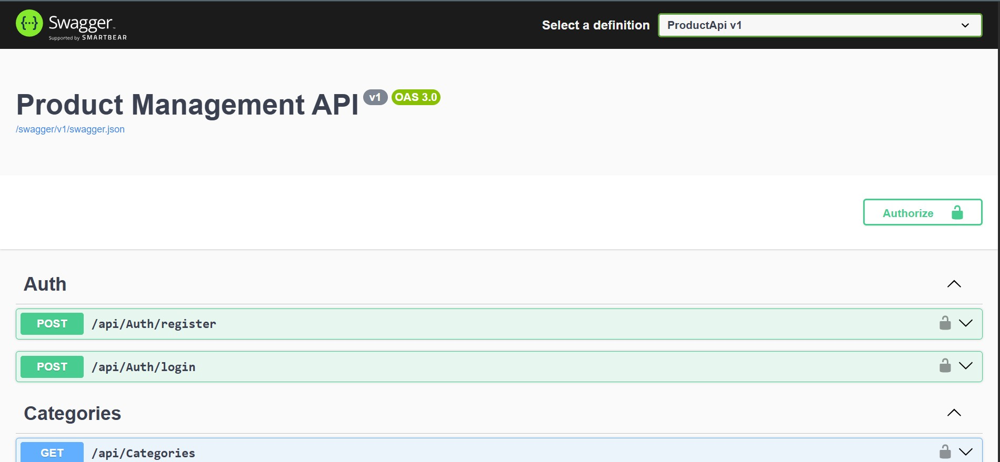
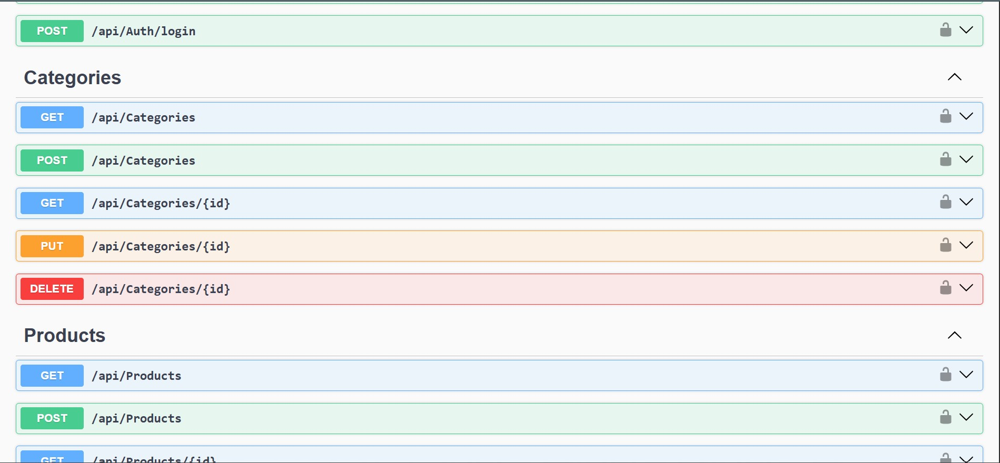

# Product Management API

A REST API built with ASP.NET Core Web API. It has JWT authentication, product and category management, and Swagger documentation for easy testing.

## Features
- User register and login with JWT token
- Categories: create, read, update, delete
- Products: create, read, update, delete
- Swagger UI to test every endpoint in the browser

## Tech Stack
- ASP.NET Core 8 Web API
- Entity Framework Core
- SQL Server LocalDB
- JWT Authentication
- Swagger / OpenAPI

## Screenshots
### API Overview

### Endpoints

## How to Run
1. Install the [.NET 8 SDK](https://dotnet.microsoft.com/download) and SQL Server LocalDB (comes with Visual Studio)
2. Open a terminal in this folder and run:

        dotnet run

3. Open the URL shown in the terminal and add `/swagger` (for example http://localhost:5002/swagger)
4. Call `POST /api/Auth/register`, then `POST /api/Auth/login`, copy the token, click **Authorize** and paste it to test protected endpoints.

The database is created automatically on first run.
